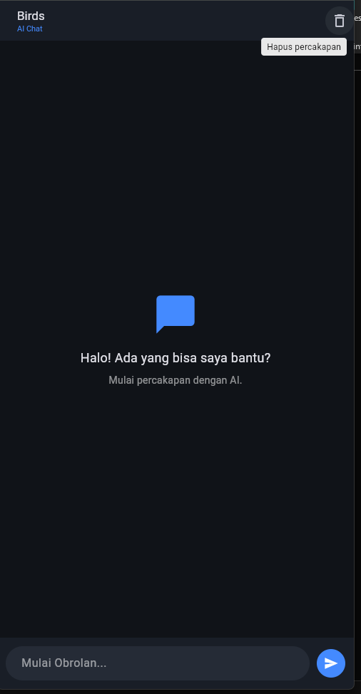

# chatbot_bird

> Aplikasi ini dibuat untuk memenuhi tugas dari Mmata Kuliah Pemograman Mobile (ST407) Universitas Aamikom Yogyakarta

[](https://flutter.dev)
[](https://dart.dev)

---

## Tampilan Antarmuka

<p align="center">
  
</p>

---

Memulai

Ikuti langkah-langkah di bawah ini untuk menjalankan proyek ini di komputer lokal Anda.

### Prasyarat
1. Pastikan Anda telah menginstal perangkat lunak berikut di komputer Anda:
    - [Flutter SDK](https://docs.flutter.dev/get-started/install) (Versi terbaru disarankan)
    - Text Editor / IDE (Visual Studio Code atau Android Studio)

2. pastikan Anda memiliki key APIopenai jika belum bisa didapatkan di web ini:
    - https://openai.com/id-ID/api/

 3. Buatlah .env dengan format berikut :
    ```env
    OPENAI_API_KEY=your_api_key_here
    OPENAI_MODEL=your_model_name
    ```
